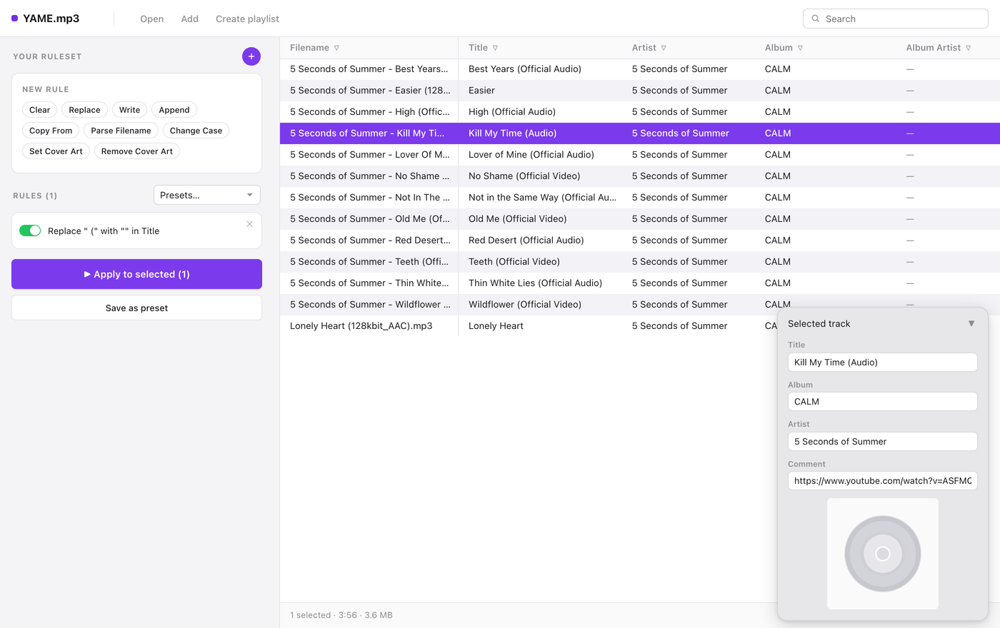

# YAME.mp3

YAME (Yet Another Metadata Editor) is an open-source batch tag editor for local music
files. The main way to edit metadata is done through user-defined rules designed for easy
reuse and customisation, so that scripting is no longer a tiny option behind a cryptic
menu. Tested for MP3, M4A, WAV, FLAC, OGG, and AIFF formats.



## Rules

Rules can be selected from the left sidebar and stacked. A ruleset can be saved as a
preset and reloaded for the next batch.

| Rule | What it does |
| --- | --- |
| Clear | Empties a field |
| Replace | Find and replace, with `*` and `?` wildcards |
| Write | Sets a field to a fixed value |
| Append | Adds text to the end of a field |
| Copy From | Copies one field into another |
| Parse Filename | Fills fields from a filename pattern, such as `* - *` |
| Change Case | UPPER, lower, Title or Sentence case |
| Set Cover Art | Embeds one image in every file |
| Remove Cover Art | Strips embedded artwork |

For Replace, `*` matches any run of characters and `?` matches exactly one.

## Building from source

You need Node 20+, [pnpm](https://pnpm.io), Python 3.13 with
[uv](https://docs.astral.sh/uv/), and Rust 1.77+.

```bash
git clone https://github.com/ZhifangL/mp3MetadataEditor.git
cd mp3MetadataEditor
```

The app is two processes, so development takes two terminals.

```bash
# engine: picks a free port and publishes it
cd mp3-metadata-api
uv sync
.venv/bin/python main.py
```

```bash
# interface: reads the published port, so the two find each other
cd mp3-desktop-frontend
pnpm install
pnpm run dev
```

The interface is at http://localhost:5173. Add `?folder=/path/to/music` to the URL to load
a folder on startup.

To build the app:

```bash
cd mp3-desktop-frontend
pnpm run package
```

That freezes the engine with PyInstaller, builds the frontend, compiles the Rust shell and
writes `YAME.app` and a `.dmg` under `src-tauri/target/release/bundle/`. A macOS build is
around 20 MB. If you change the engine, run `pnpm run sidecar` before
`pnpm run desktop:dev`, which uses whatever engine is already staged.

Tests:

```bash
(cd mp3-metadata-api && .venv/bin/python -m pytest)
(cd mp3-desktop-frontend && pnpm test)
(cd mp3-desktop-frontend/src-tauri && cargo test)
```

### Signing

The macOS build is signed ad-hoc (`signingIdentity: "-"`). The engine needs the
`disable-library-validation` entitlement as well, because PyInstaller unpacks `libpython`
to a temporary directory and the Hardened Runtime refuses to load a library signed by a
different team. For a download that opens without a warning, set `signingIdentity` to a
Developer ID and add notarisation.

## License

GPL-3.0-or-later. See [LICENSE](LICENSE). Built with
[FastAPI](https://fastapi.tiangolo.com), [mutagen](https://mutagen.readthedocs.io) and
[Tauri](https://tauri.app).
